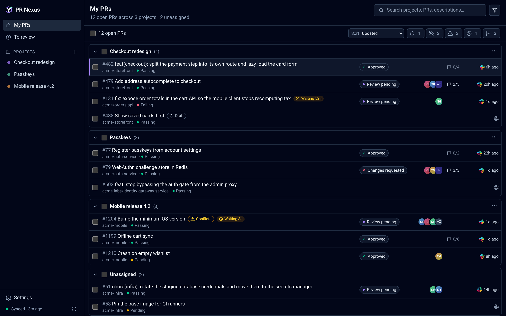

# PR Nexus

[](https://github.com/harnesstap/pr-nexus/actions/workflows/ci.yml)
[](https://github.com/harnesstap/pr-nexus/releases/latest)
[](LICENSE)
[](#install)

Desktop app (Tauri + Rust) to track your open GitHub pull requests by project and request or bump reviews from the owning teams on Slack.

https://github.com/user-attachments/assets/1c81dc94-66ef-49bc-82b8-6978ae3dc081

<sub>PR Nexus in 30 seconds (with music). Fictional data.</sub>



<sub>Mock data. Regenerate with `cd app && bun run screenshot` (needs Chrome, or set `CHROME_PATH`).</sub>

The v1 technical specification is [docs/SPEC.md](docs/SPEC.md). Agent instructions are in [AGENTS.md](AGENTS.md). The release and branch-ruleset runbook is in [CONTRIBUTING.md](CONTRIBUTING.md).

## Install

Every release ships installers for macOS (Apple Silicon), Linux (x86_64 and arm64) and Windows (x64), plus a `SHA256SUMS` file. Linux and Windows installers start with v0.1.1. Builds are not notarized or code signed yet, so each OS warns on first launch.

### macOS

With [Homebrew](https://brew.sh):

```bash
brew install --cask harnesstap/tap/pr-nexus
```

Upgrade with `brew upgrade --cask pr-nexus`.

macOS blocks the first launch because the app is not notarized. Open **System Settings > Privacy & Security** and click **Open Anyway** once. The cask does not remove the quarantine flag for you.

Without Homebrew, download the DMG from [Releases](https://github.com/harnesstap/pr-nexus/releases/latest), or with `gh`, which does not set the quarantine flag:

```bash
gh release download vX.Y.Z -R harnesstap/pr-nexus -p '*.dmg'
```

Each new version asks once for permission to use the keychain item `dev.pr-nexus`; choose Always Allow. Details are in CONTRIBUTING.

### Linux

```bash
curl -fsSL https://raw.githubusercontent.com/harnesstap/pr-nexus/main/scripts/install.sh | sh
```

The script installs the `.deb` with apt on Debian and Ubuntu, the `.rpm` with dnf or zypper on Fedora, RHEL and openSUSE, and otherwise puts the AppImage in `~/.local/bin` with a desktop entry. It checks every download against `SHA256SUMS`. Set `PR_NEXUS_DRY_RUN=1` to see what it would do, or `PR_NEXUS_METHOD=deb|rpm|appimage` to choose. Rerun it to upgrade.

Or install a package from [Releases](https://github.com/harnesstap/pr-nexus/releases/latest) yourself:

```bash
sudo apt install ./PR-Nexus_X.Y.Z_amd64.deb          # Debian, Ubuntu
sudo dnf install ./PR-Nexus-X.Y.Z-1.x86_64.rpm       # Fedora, RHEL
chmod +x PR-Nexus_X.Y.Z_amd64.AppImage && ./PR-Nexus_X.Y.Z_amd64.AppImage
```

ARM64 uses `_arm64.deb`, `-1.aarch64.rpm` and `_aarch64.AppImage`. Tokens are stored with the Secret Service (GNOME Keyring or KWallet); if none is running, PR Nexus shows a keyring banner instead of saving tokens.

### Windows

Download `PR-Nexus_X.Y.Z_x64-setup.exe` (per-user install) or `PR-Nexus_X.Y.Z_x64_en-US.msi` from [Releases](https://github.com/harnesstap/pr-nexus/releases/latest). The installers are not code signed, so SmartScreen shows "Windows protected your PC": click **More info**, then **Run anyway**. Tokens are stored in Windows Credential Manager. A WinGet package is planned.

## Develop

- Rust stable (`rust-toolchain.toml`)
- Bun 1.3.14

```bash
bun install --cwd app
bun run tauri dev
```

Linux needs the WebKitGTK packages listed in `.github/actions/linux-tauri-deps/action.yml`.

## License

MIT. See [LICENSE](LICENSE).
