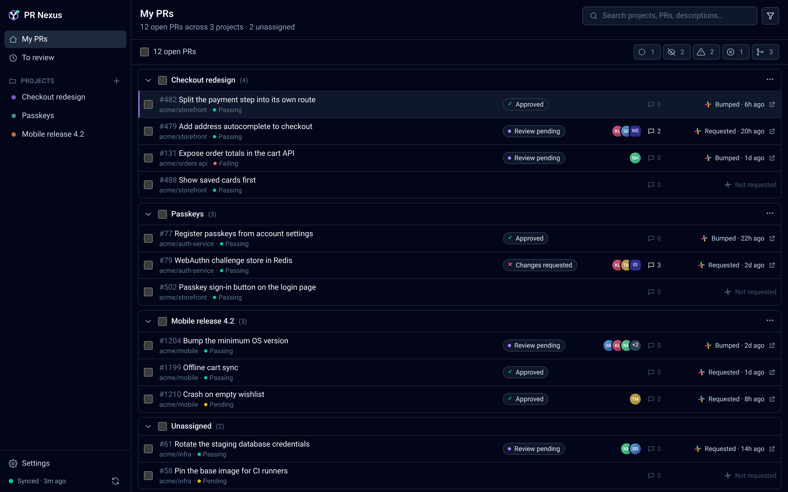

# PR Nexus

[](https://github.com/harnesstap/pr-nexus/actions/workflows/ci.yml)
[](https://github.com/harnesstap/pr-nexus/releases/latest)
[](Cargo.toml)
[](#install)

Desktop app (Tauri + Rust) to track your open GitHub pull requests by project and request or bump reviews from the owning teams on Slack.



<sub>Mock data. Regenerate with `cd app && bun run screenshot` (needs Chrome, or set `CHROME_PATH`).</sub>

The v1 technical specification is [docs/SPEC.md](docs/SPEC.md). Agent instructions are in [AGENTS.md](AGENTS.md). The release and branch-ruleset runbook is in [CONTRIBUTING.md](CONTRIBUTING.md).

## Install

PR Nexus ships an ad-hoc signed macOS Apple Silicon DMG. It is not notarized by Apple yet. Linux and Windows compile in CI and are not released.

With [Homebrew](https://brew.sh):

```bash
brew install --cask harnesstap/tap/pr-nexus
```

Upgrade with `brew upgrade --cask pr-nexus`.

macOS blocks the first launch because the app is not notarized. Open **System Settings > Privacy & Security** and click **Open Anyway** once. The cask does not remove the quarantine flag for you.

Without Homebrew, download the DMG from [Releases](https://github.com/harnesstap/pr-nexus/releases/latest), or with `gh`, which does not set the quarantine flag:

```bash
gh release download vX.Y.Z -R harnesstap/pr-nexus -p '*.dmg'
```

Each new version asks once for permission to use the keychain item `dev.pr-nexus`; choose Always Allow. Details are in CONTRIBUTING.

## Develop

- Rust stable (`rust-toolchain.toml`)
- Bun 1.3.14

```bash
cd app
bun install
bun run tauri dev
```

Linux needs the WebKitGTK packages listed in `.github/actions/linux-tauri-deps/action.yml`.
